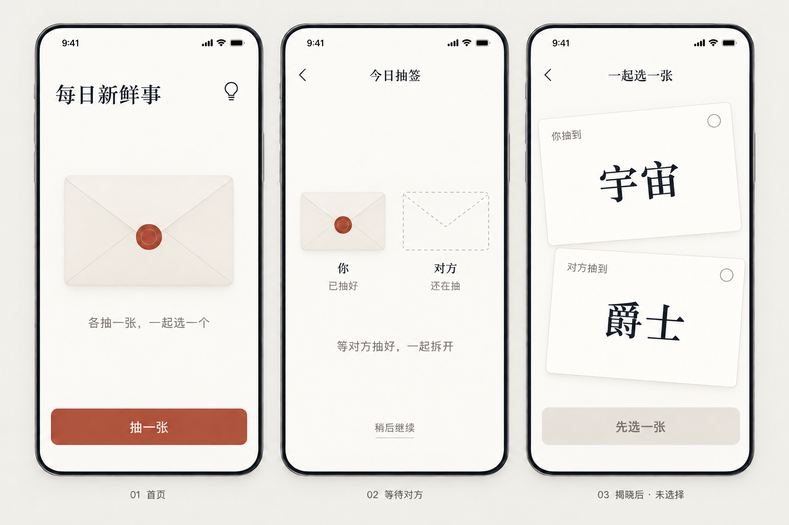
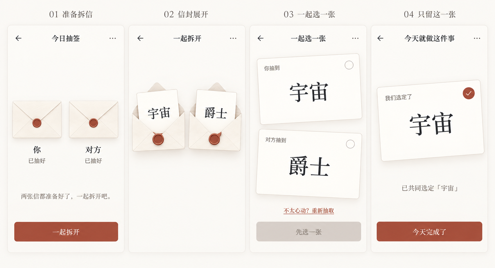

# 视觉基线

本图由内置 imagegen 生成，用户在“卡片不要对齐”的修订后明确选择按此继续。属于视觉概念参考，不是真机截图。

实现保持暖白、墨色、赤陶强调色和轻宋体；两张结果卡同样大小和视觉分量，分别轻微偏移和旋转，初始都未选择。

本期只做每日新鲜事和灵感管理，抽取前隐藏候选词。具体接口与业务边界以 ../IMPLEMENTATION.md 为准。

## 2026-10-19 字体与动效修订

用户在静态图与交互原型预览后明确要求按此实现。本图由内置 imagegen 生成，是概念稿，不是线上或真机证据。排布与字体以本轮真实浏览器检查补充核验。

- 全站使用自托管 Noto Serif SC 400，保留暖白、墨色、赤陶色、两张等大错位纸卡。
- 拆信约 1.8 秒：封蜡先松开，封口绕上边翻起，卡片浮出并展开为上下两张。仅在服务端共同揭晓后播放。
- 重抽需双方同意，旧卡约 0.55 秒淡出后回到两封新信，再一起拆开。每次必须是两张不同的新灵感；可用替代不足则保留原卡。
- 共同选定后，未选卡约 0.56 秒退出，所选卡约 1 秒移至中央；最终只渲染这一张，包括完成状态。刷新直接显示稳定结果，减少动态效果设置跳过过渡。

`app/components/round-motion.tsx` 负责过渡，实际共享协议以 `../IMPLEMENTATION.md` 和 `app/contracts.ts` 为准。字体许可证与来源摘要在 `public/fonts/`；用户参考照片与 QA 截图继续保留在忽略目录。
